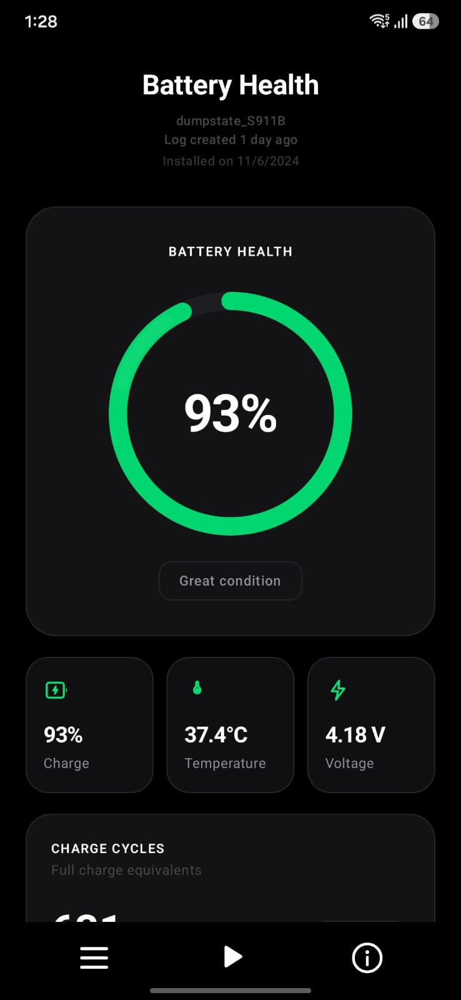
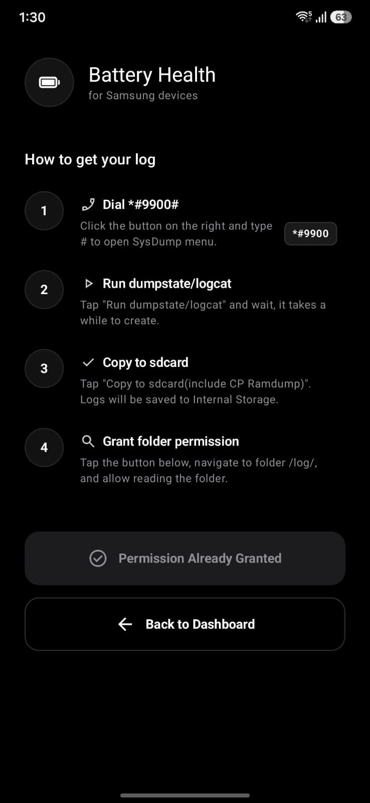
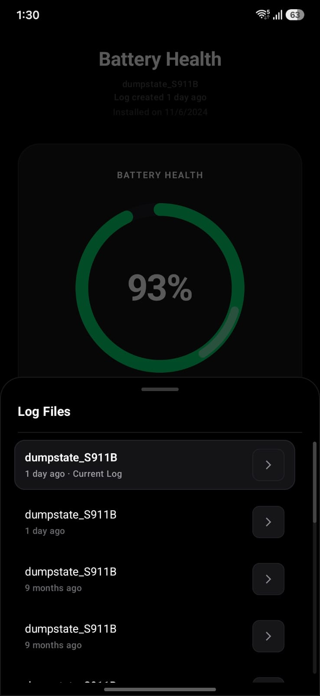
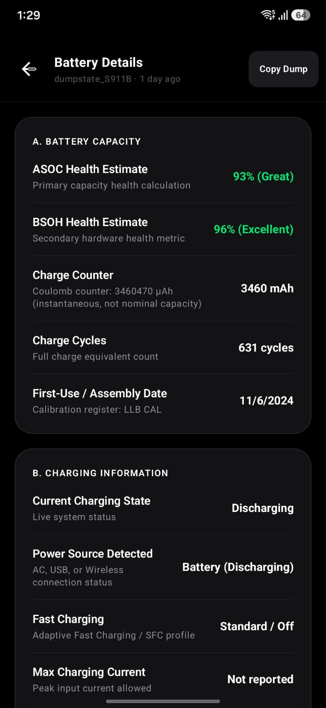

# Battery Health

A lightweight, privacy-focused utility to inspect genuine battery health, charge cycle counts, and electrical diagnostics on Samsung Galaxy devices.

  
  

  
  

---

## How to Use

1. Open the Phone app and dial `*#9900#` to open Samsung SysDump.
2. Tap **Run dumpstate/logcat** and wait for it to finish.
3. Tap **Copy to sdcard(include CP Ramdump)** to export logs to `/sdcard/log/`.
4. Open **Battery Health** and grant access to the `log` folder to view your statistics.

---

## What It Reads

Battery Health extracts official battery controller registers directly from the Samsung dumpstate log:

- **mSavedBatteryAsoc (Primary Health):** Battery health percentage calculated by Samsung algorithm.
- **mSavedBatteryBsoh (Fallback Health):** Secondary hardware state-of-health register.
- **mSavedBatteryUsage (Cycle Count):** Total charge cycles logged by the battery management system.
- **LLB CAL / LLB MAN (Manufacturing Date):** Battery pack manufacturing and assembly date.
- **Live Readings:** Real-time charge level, temperature, and voltage.

---

## Notice

> [!IMPORTANT]
> Battery Health is an independent open-source utility and is not affiliated with Samsung. All battery metrics depend on the dumpstate logs generated by the device.

---

## Credits

This project is a fork of [MyBattery](https://github.com/Alyaqdhans/MyBattery).
